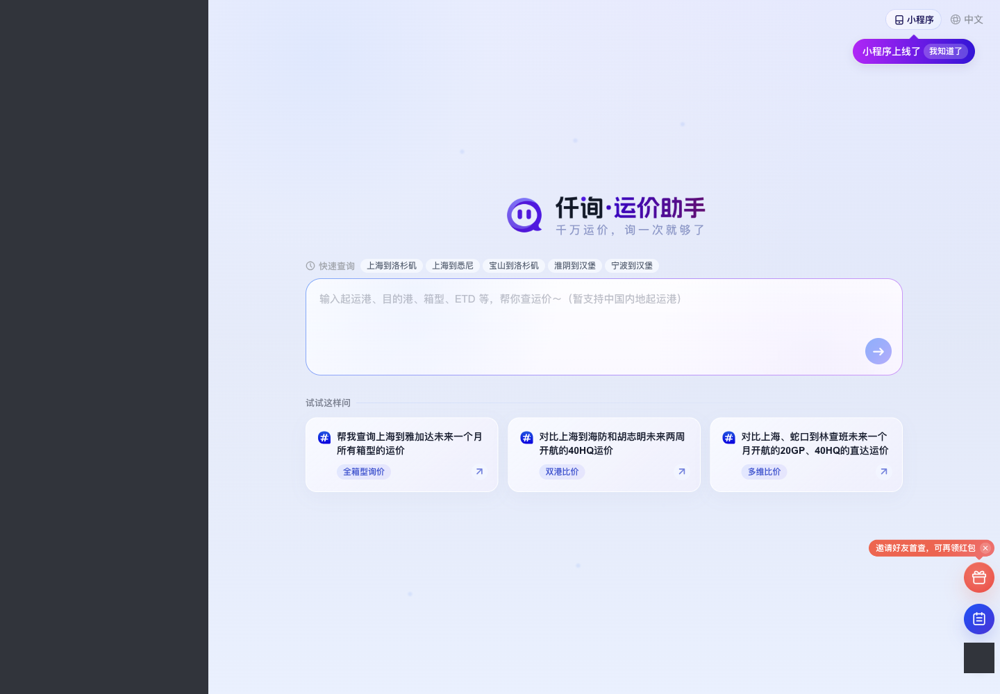

# 需求 0006：重启后可复用的 Playwright 测试登录

本版核心能力已交付，实际结果与未覆盖项见[验收记录](acceptance.md)。execution_phase 的 done 表示本轮实现与聚焦验证已结束，不表示真实整机重启、人工补登及所有条件性场景均通过。

## 现状：现在能做到什么

E01 已验证：用户在专用测试窗口 A 手动登录，保持 A 打开；独立测试环境 B 无需再次登录，真实身份响应的账号和企业均与 A 一致。Playwright Test 1.60.0 最终运行 11 项断言通过，约 5 秒，不含人工登录。登录态仅在内存传递，没有跨运行保存。

```text
N01 Agent 接到测试任务
  → N02 查找仍在运行的专用登录窗口
  → N03 把当前登录交给独立测试环境
  → N04 核对账号、企业及页面可用
  → N05 允许继续测试
```

最小例子：A 仍打开时，B 可直接进入 Beta 业务页。若关机，旧进程和调试端口不再存在；当前演示未交付重启后的入口，不能据此继续免登。

E02 旧尝试：只保留 profile 并重启浏览器，没有恢复出可用登录；原因未证实。它不是“Playwright 无法复用”的证据。

本需求不修改被测网站的界面。现有页面截图仅为历史运行观察，不是当前线上新事实：



## 需求重定义

**原始诉求**：能力能复用，关机后重新开机，Agent 依然能直接使用 Playwright 执行测试用例。

**最终目标**：登录有效时不反复要求人工登录，Agent 有稳定、可发现的执行入口，测试与日常浏览互不争抢；无效身份不能进入后续业务操作。

**异议与限制**：“重启仍可用”不等于永久免登。服务器可能使登录过期或撤销权限；正确结果是识别失效并请求补登，不能伪造或绕过登录。一次新进程恢复通过，也不能写成已经做过真实整机重启。

**本版边界**：先固化跨运行的共用能力，以已验证的 HGJ client / Beta 页面作为第一条真实接入。其他站点、admin 账号体系不自动宣称已接入。保存方式与程序组织属于后续设计，不在本阶段冻结。

## 新旧链路与差异

```text
N01 Agent 接到测试任务〔保持〕
  → N02 选择已确认的环境、账号及企业〔修改，D01〕
  → N03 恢复此前获准保存的测试登录〔修改，D02〕
  → N04 在独立测试环境验证身份〔修改，D03〕
      ├─ 有效且符合预期 → N05 执行明确指定的用例〔保持〕
      ├─ 登录失效/无状态 → N06 专用窗口人工补登〔新增，D04〕
      │                      → 回到 N03，再验证后继续
      └─ 身份不符/服务异常 → 停止，报告原因，不执行业务〔新增，D03〕
  → N07 输出结果并收尾本次测试资源〔修改，D05〕
```

| 差异 | 原来 → 目标及最小例子 | 后续影响 | 依据与验收 |
| --- | --- | --- | --- |
| D01 / 修改 / N02 | 临时演示入口 → Agent 可发现的固定能力入口；换个会话仍能找到，不要求记住旧端口 | 调用不依赖本轮 Agent 的上下文 | 用户目标；R01；用例 v1 |
| D02 / 修改 / N03 | 仅内存复用 → 获准保留的登录可跨进程读取；关闭上轮测试进程后，新进程仍可验证有效身份 | 不要求专用浏览器一直运行 | 用户目标；R02；用例 v1 |
| D03 / 修改 / N04 | 演示时人工核对 → 每次在业务操作前核对真实身份；例如期望企业 A，读到企业 B 必须停止 | 不静默跨账号、跨企业测试 | E01、由目标推导；R03；用例 v1 |
| D04 / 新增 / N06 | 失败后反复试启动 → 明确补登交接；例如登录已失效时只等待用户补登，不发送测试消息 | 减少重复认证与越权业务操作 | 用户免登目标的必要失败路径；R04；用例 v1 |
| D05 / 修改 / N07 | 演示文件绑定旧端口 → 输出本次身份校验及测试结果，结束只关闭自己的资源 | 日常浏览与其他任务不受影响 | 用户原始约束；R05、R06；用例 v1 |

## 用户故事与规则

1. As a 测试任务发起人, I want 重新开机后 Agent 仍能找到登录复用入口, so that 不需要重新解释本机启动方式。
2. As a 页面测试执行者, I want 登录有效时直接运行指定用例, so that 不必每条用例重复登录。
3. As a 账号使用者, I want 失效或身份不符时先停止, so that 自动化不会用错误身份操作业务。

- R01：共用方法唯一维护，现有测试入口按需引用，不新增相互竞争的网页自动化默认入口。首次接入范围明确显示为 HGJ client / Beta。
- R02：只有用户明确允许后，才能在本机私密位置保存可用于认证的状态；范围限获准环境的业务域、登录域和身份服务所需状态，仅供当前本机用户获准测试使用，不读其他站点档案；不得写入 Git、需求附件、日志或模型输出。撤回授权后停止读取和复用，清除保存状态需另行确认，不擅自删除。不得依赖旧进程和旧临时端口。保存方案在设计阶段确定。
- R03：在每轮业务测试前确认真实身份、企业和页面可用。HTTP 200、有账号按钮或本地存有状态文件，都不能单独作为成功依据。测试传入的预期身份必须明确；第一次建立基线由用户确认，不把任意返回的账号自动视为正确。缺少账号或当前企业标识、身份响应无法解释、预期身份未提供时，判定校验未完成并停止，不自动判为需要重登。
- R04：无登录、过期或已撤销时请求人工补登；身份不符、身份无法确定和网络/服务异常单独报告，不误判为必须重登。补登不读取密码库、不代填密码。成功交接前保留登录窗口；取消或超时不执行业务动作。
- R05：每个测试有独立浏览环境；共享服务端业务状态是否允许并发另行判断。本轮连续与小规模并发验证只使用身份只读检查，不触发查价。
- R06：只管理自己创建的测试资源，不启动开机常驻服务、不接管日常 Chrome、不终止其他浏览器。指定用例的原始操作授权仍独立成立；保存登录不构成未来查价/提交的永久授权。
- R07：新进程恢复和真实整机重启分别记录。无需人为等待登录过期才能完成实现；失效与错误身份在本地受控夹具验证，不能对真实服务做撤权/破坏性实验。

## 不做什么

- 不承诺永久免登，不绕过验证码、企业选择或服务端权限。
- 不发送查价消息，不恢复旧查价会话，不修改被测业务代码、配置或数据库。
- 不把全部网站、全部角色或全部账号接入作为第一版交付。
- 不复制日常 Chrome 完整档案，不启用后台常驻平台，不全局安装新依赖或自动升级工具。
- 不主动重启整机；用户自行完成整机重启前，只能交付新进程恢复证据及重启后操作入口。

## 用例与执行约定

- 用例：[按场景分组的用例 v1](test-cases.wl-qa-test-planner.html)；唯一正文：[Markdown](test-cases.wl-qa-test-planner.md)。尚未执行，不把用例生成当成通过。
- 正式基线独立审查：2026-10-20 执行者只读审查，指出身份无法确认的停止规则及整机重启通过口径缺口，本版已补齐；用例 v1 同步修订。该审查不是实现或运行验收。用户已在本会话选择“批准并实施（推荐）”，本版范围与本机持久保存获准。
- 已获准访问：HGJ client / Beta 登录和业务页；范围只读身份验证、用户手动登录及独立测试页创建。新业务写操作仍需另行明确授权。
- 本轮可模拟关闭旧进程、在新进程加载并检查状态；不能声称已完成真正关机开机。

## 来源、证据与待确认

- S01：本会话用户“能力能复用，比如关机了，启动后依然可以 Agent 最直接地使用 Playwright 进行测试用例测试”。
- E01：2026-10-20 13:39，Beta 实际运行。报告：`/Users/ziyun/.local/state/web-task/runs/playwright-auth-reuse-demo-20261020/RESULT.md`；断言：同目录 `reuse-verified-result.json`；11 项断言通过。附件为同次已脱敏 B 页面。局限：仅运行中浏览器 A→独立 B，没有跨进程恢复或并发。
- E02：同日此前失败记录：`/Users/ziyun/.local/state/web-task/runs/playwright-freight-demo-20261020/run-12-final-report.md`；跨重启 profile 未恢复身份，根因未确定。
- E03：本轮核对工作台工具接入入口及现有测试能力，未发现已交付的重启后登录恢复共用入口；现有演示绑定外部项目 runner 和临时 CDP。静态检查不证明其他自定义目录没有类似脚本。
- Q01：已解决。用户于 2026-10-20 本会话选择“批准并实施（推荐）”，允许在仓库外本机私密目录持久保存必要测试登录态；不包含其他环境、其他账号或业务提交的永久授权。
